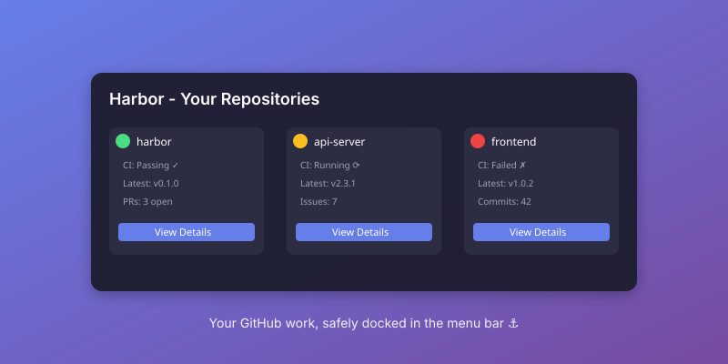

# Harbor ⚓

> Your development work, safely docked in the menu bar

Harbor keeps your GitHub and Azure DevOps work close without pulling you into a browser. Pin the repositories that matter and get a calm, glanceable view of CI, releases, work items, activity, and local Git state—right from your menu bar.

Think of Harbor as your **home port**: everything important in one place, always in sight, never noisy.

**GitHub** • **Azure DevOps** • **GitLab** • **Local Git**



**CI status** • **Releases** • **Activity & traffic** • **Local Git state**

---

## 📦 Installation

Harbor is available for **macOS** (currently) with multi-platform support planned.

### macOS

#### Homebrew (Recommended)

```bash
brew install --cask sriinnu/tap/harbor
```

#### Direct Download

Download the latest `.dmg` from the [releases page](https://github.com/sriinnu/Harbor/releases/latest):

1. Download `Harbor-macOS.dmg`
2. Open the DMG file
3. Drag Harbor to your Applications folder
4. Launch Harbor from Applications
5. Grant permissions when prompted:
   - **Menu Bar access**: Required for the menu bar icon
   - **Keychain access**: Required to securely store your GitHub token
   - **Network access**: Required to communicate with GitHub API

**First Launch**:
- On macOS, you may see a security prompt because the app is not notarized yet
- Go to System Preferences → Privacy & Security → Open Anyway
- This is a one-time step

#### Build from Source

**Requirements**:
- macOS 15.0+ (Sequoia or later)
- Xcode 16.2+
- Swift 6.0+
- Command Line Tools: `xcode-select --install`

**Build Steps**:

```bash
# Clone the repository
git clone https://github.com/sriinnu/Harbor.git
cd Harbor

# Build using the provided build script (recommended)
./Scripts/build.sh

# Cross-platform build (auto-selects the platform script)
pnpm build

# The built app will be at:
# build/macos/Build/Products/Debug/Harbor.app

# Run the app
open build/macos/Build/Products/Debug/Harbor.app

# Or run directly from command line for debugging
build/macos/Build/Products/Debug/Harbor.app/Contents/MacOS/Harbor
```

**Alternative Build Methods**:

```bash
# Using xcodebuild directly
xcodebuild \
    -scheme Harbor \
    -destination 'platform=macOS,arch=arm64' \
    -configuration Debug \
    -derivedDataPath "./build/macos" \
    build

# Using Swift Package Manager (for development)
swift build -c debug --build-path "./build/macos/.build"

# Note: SPM builds won't include all resources/frameworks
# Use xcodebuild for full app builds
```

**Build Artifacts**:
- All build artifacts are stored in the `build/<platform>/` directory
- `pnpm build` dispatches to platform scripts: macOS `Scripts/build.sh`, Linux `Scripts/build-linux.sh`, Windows `Scripts/build.ps1`
- The root directory stays clean
- To clean: `./Scripts/cleanup.sh` or `rm -rf build/`

#### Development Scripts

Harbor includes several scripts to streamline development:

```bash
# === Quick Start: Clean + Build + Run ===
./Scripts/dev.sh all              # Clean → Build → Run app
./Scripts/dev.sh all cli          # Clean → Build → Run CLI

# === Individual Commands ===
./Scripts/dev.sh build            # Build app (debug)
./Scripts/dev.sh cli              # Build CLI only
./Scripts/dev.sh run              # Build + Run app
./Scripts/dev.sh xcode            # Open in Xcode
./Scripts/dev.sh test             # Run tests
./Scripts/dev.sh clean            # Clean build artifacts
./Scripts/dev.sh deps             # Update dependencies

# === Cleanup ===
./Scripts/cleanup.sh              # Standard cleanup (build files)
./Scripts/cleanup.sh full         # Full cleanup (including caches)

# === Direct Build ===
./Scripts/build.sh                # Build app (same as dev.sh build)
./Scripts/build.sh cli            # Build CLI only
./Scripts/build.sh release        # Build release version
./Scripts/build.sh clean          # Clean build directory
```

**Build Outputs**:
| Target | Location |
|--------|----------|
| App | `build/macos/Build/Products/Debug/Harbor` |
| CLI | `build/macos/Build/Products/Debug/harbor` |

**Run the App**:
```bash
# Using the script (recommended - handles Sparkle framework)
./Scripts/dev.sh run

# Or directly with library path
DYLD_LIBRARY_PATH="$(pwd)/build/macos/Build/Products/Debug" ./build/macos/Build/Products/Debug/Harbor &
```

**Run the CLI**:
```bash
./build/macos/Build/Products/Debug/harbor --help
./Scripts/dev.sh all cli          # Clean + build + run CLI
```

---

### Windows

#### Download (Recommended)

Download the latest installer from the [releases page](https://github.com/sriinnu/Harbor/releases/latest):

1. Download `Harbor-Windows-Setup.exe`
2. Run the installer
3. Harbor will appear in your system tray
4. Click the tray icon to get started
5. Grant permissions when prompted:
   - **Windows Credential Manager**: Required for secure token storage
   - **Network access**: Required for GitHub API communication

**First Launch**:
- Windows may show a SmartScreen warning (app not yet signed)
- Click "More info" → "Run anyway"
- This is a one-time step

#### Build from Source

**Requirements**:
- Windows 10 (1809+) or Windows 11
- [Rust](https://rustup.rs/) (latest stable - 1.70+)
- [Node.js](https://nodejs.org/) 18+ (LTS recommended)
- [Visual Studio Build Tools](https://visualstudio.microsoft.com/downloads/) 2019 or later
  - With "Desktop development with C++" workload

**Build Steps**:

```bash
# Clone the repository
git clone https://github.com/sriinnu/Harbor.git
cd Harbor/harbor-windows

# Install frontend dependencies
npm install

# Build and run in development mode (with hot reload)
npm run tauri dev

# Build for production
npm run tauri build

# The installer will be in:
# src-tauri/target/release/bundle/msi/Harbor_x.x.x_x64_en-US.msi
# src-tauri/target/release/bundle/nsis/Harbor_x.x.x_x64-setup.exe
```

**Development Tips**:
```bash
# Run Rust tests
cd src-tauri
cargo test

# Run frontend tests
npm test

# Check Rust code
cargo clippy

# Format code
cargo fmt
npm run format
```

**Windows Build Script**:
```powershell
# PowerShell (run from project root)
.\Scripts\build.ps1              # Build debug
.\Scripts\build.ps1 release      # Build release
.\Scripts\build.ps1 clean        # Clean artifacts
.\Scripts\build.ps1 deps         # Install dependencies
.\Scripts\build.ps1 run          # Run in dev mode
```

**Requirements**:
- PowerShell 7+
- Rust + Cargo
- Node.js 18+
- Visual Studio Build Tools with C++ workload


---

### Linux (Coming Soon)

Linux support is planned. The platform abstraction layer is ready, implementation coming soon.

**Linux Build Script**:
```bash
# Bash (run from project root)
./Scripts/build-linux.sh         # Build debug
./Scripts/build-linux.sh release # Build release
./Scripts/build-linux.sh clean   # Clean artifacts
./Scripts/build-linux.sh deps    # Install dependencies
./Scripts/build-linux.sh run     # Run in dev mode
./Scripts/build-linux.sh package # Create .deb / AppImage
```

**Requirements**:
- Ubuntu 20.04+ / Debian 11+ / Fedora 36+ / Arch Linux
- Rust + Cargo
- Node.js 18+
- webkit2gtk, gtk3, libappindicator

---

### Web (Coming Soon)

A web version for cross-platform access is in development.

**Planned Features**:
- Access Harbor from any browser
- Sync settings across devices
- Read-only view for quick checks
- Progressive Web App (PWA) support

---

### Cross-Platform Architecture

See [docs/CROSS_PLATFORM.md](docs/CROSS_PLATFORM.md) for detailed information about:
- Multi-platform architecture decisions
- Tauri migration plan for Windows/Linux
- Web/PWA implementation strategy
- Shared component design

---

## ✨ Features

### Core Features

#### Live Repository Cards
Get instant visibility into your repositories without opening a browser:
- **CI/CD Status**: See workflow runs, build status, and test results at a glance
- **Recent Activity**: Latest commits, PRs, and issues
- **Release Information**: Current version, release notes, and update notifications
- **Rate Limit Awareness**: Visual indicators when approaching GitHub API limits
- **Smart Caching**: Fast loading with intelligent background updates

#### Rich Submenus
Drill into details without leaving the menu bar:
- **Pull Requests**: Open PRs with status, reviewers, and checks
- **Issues**: Active issues with labels, assignees, and milestones
- **Releases**: Version history, changelogs, and asset downloads
- **Workflow Runs**: CI/CD pipeline status and logs
- **Discussions**: GitHub Discussions integration
- **Tags & Branches**: Quick navigation to refs
- **Commits**: Recent commit history with diffs

#### Global Activity Feed
Track your contribution activity across all repositories:
- **Contribution Heatmap**: Visual calendar of your GitHub activity
- **Per-Repository Graphs**: Activity trends for each repo
- **Customizable Time Ranges**: Last 7 days, 30 days, 90 days, or year
- **Activity Breakdown**: Commits, PRs, issues, reviews

#### Local Git State Integration
Bridge GitHub cloud data with your local Git repositories:
- **Automatic Repository Matching**: Scans your projects folder
- **Branch Information**: Current branch, upstream tracking
- **Ahead/Behind Status**: See how many commits ahead or behind remote
- **Dirty State Detection**: Uncommitted changes indicator
- **Worktree Support**: Multiple working trees per repository
- **Quick Actions**: Open in Finder/Terminal, pull, push, sync
- **Fast-Forward Auto-Sync**: Optional automatic pulls (safe, no force)
- **Configurable Sync Cadence**: Set fetch intervals

#### Smart Organization
Customize your view to focus on what matters:
- **Pin Repositories**: Keep important repos at the top
- **Hide Repositories**: Declutter your view
- **Menu Filters**: Filter by type, state, author, labels
- **Configurable Sorting**: Activity, name, stars, custom order
- **Search**: Fast repository search
- **Fork Filtering**: Show/hide forked repositories
- **Archive Filtering**: Show/hide archived repositories

#### Fast Native UI
Built for performance:
- **SwiftUI (macOS)**: Native, smooth, and responsive
- **React + Tauri (Windows)**: Near-native performance
- **Smart Caching**: Minimize API calls
- **Layout Reuse**: Efficient rendering
- **Debounced Refresh**: Intelligent update throttling
- **Rate Limit Handling**: Automatic backoff
- **Offline Mode**: Local Git features work without internet

#### Auto-Updates
Stay current effortlessly:
- **Sparkle Framework (macOS)**: Automatic update checks
- **Background Downloads**: Updates download in the background
- **Release Notes**: See what's new before updating
- **Optional Auto-Install**: Update on quit or manual install

#### CLI Tool
Powerful command-line interface for automation:
- **Repository Listing**: `harbor repos`
- **Issue Management**: `harbor issues`
- **PR Management**: `harbor pulls`
- **Local Project Info**: `harbor local-projects`
- **Authentication**: `harbor login`, `harbor verify`
- **JSON Output**: For scripting and automation
- **Plain Text Mode**: No colors/links for parsing

---

### Platform-Specific Features

#### macOS
- **Native SwiftUI App**: Built with Apple's latest UI framework
- **Menu Bar Integration**: Lives in your menu bar, out of your way
- **macOS Keychain**: Secure token storage using system Keychain
- **Finder Integration**: Quick actions to open repos in Finder
- **Terminal Integration**: Open repos in Terminal.app
- **System-Wide Hotkeys**: Configurable keyboard shortcuts
- **Launch at Login**: Auto-start with macOS
- **Multi-Display Support**: Works across all your screens
- **Dark Mode**: Automatic theme switching
- **Notification Center**: Native macOS notifications

#### Windows (Coming Soon)
Windows support is planned for a future release.

---

## 🎨 User Interface & Experience

### Liquid Glass Design

Harbor features a beautiful **liquid glass interface** inspired by modern design trends:

#### Visual Design
- **Animated Gradients**: Smooth, flowing background animations
- **Ultra-Thin Material Blur**: Frosted glass effect throughout
- **Depth & Layers**: Subtle shadows and elevation
- **Smooth Transitions**: Spring animations and hover effects
- **Adaptive Colors**: Automatically adjusts for light/dark mode
- **Glow Effects**: Interactive elements light up on hover

#### Design Principles
- **Calm Aesthetics**: Beautiful without being distracting
- **Glanceable Information**: Quick status checks at a glance
- **Focused Interface**: No clutter, just what you need
- **Responsive Feedback**: Immediate visual response to interactions
- **Consistent Experience**: Same look and feel across all platforms

#### Customization
- **Theme Options**: Light, Dark, or Auto (follows system)
- **Menu Density**: Compact or Comfortable spacing
- **Card Styles**: Minimal or Detailed views
- **Color Schemes**: Multiple accent color options
- **Opacity Control**: Adjust blur and transparency levels

---

## 🚀 Getting Started

### First Launch

#### Step 1: Launch Harbor
- **macOS**: Open from Applications folder, Harbor appears in menu bar
- **Windows**: Launch from Start Menu, Harbor appears in system tray

#### Step 2: Sign In with GitHub

Harbor uses **OAuth 2.0** for secure authentication:

1. Click the Harbor icon in your menu bar/tray
2. Click "Sign In with GitHub"
3. Your browser will open to GitHub's authorization page
4. Review the permissions Harbor is requesting:
   - **Read repository information**: View repo details, issues, PRs
   - **Read user profile**: Get your username and avatar
   - **Read notifications**: Check for activity
5. Click "Authorize Harbor"
6. Browser will redirect to `http://localhost:53682/callback`
7. Harbor will securely store your token:
   - **macOS**: Stored in macOS Keychain
   - **Windows**: Stored in Windows Credential Manager
   - **Privacy**: Token never leaves your device, never logged

**Important**: Harbor uses **GitHub OAuth Apps**, not GitHub Apps. This means:
- Simpler setup, no organization installation required
- Works with personal accounts and organizations
- Standard OAuth scopes (repo, user, notifications)

#### Step 3: Pin Your Repositories

After signing in, you'll see your repositories:

1. **Browse**: Scroll through your repository list
2. **Search**: Use the search box to find specific repos
3. **Pin**: Click the pin icon (📌) next to important repositories
4. **Pinned repos appear at the top** of your menu
5. **Customize sorting**: Choose sort order in settings

**Tips**:
- Pin repos you check frequently (active projects, CI dashboards)
- Use search filters to narrow down large repo lists
- Hide repos you don't need to see

#### Step 4: Configure Settings (Optional)

##### Local Projects Folder
Point Harbor at your local Git repositories:

1. Open Settings (gear icon)
2. Set "Local Projects Folder":
   - **macOS**: `~/Projects`, `~/Developer`, `~/Code`, etc.
   - **Windows**: `C:\Users\YourName\Projects`, `D:\Code`, etc.
3. Harbor will scan and match repositories automatically
4. You'll see local Git status alongside GitHub data

##### Auto-Sync
Enable automatic repository syncing:

1. In Settings → Repositories → Auto-Sync
2. Enable "Auto-sync local repositories"
3. Set sync interval (default: 15 minutes)
4. Configure notification preferences

**Auto-Sync Behavior**:
- ✅ Only syncs clean repositories (no uncommitted changes)
- ✅ Fast-forward merges only (safe pulls)
- ✅ Respects .gitignore and Git configuration
- ❌ Never force-pulls or overwrites local changes
- ❌ Skips repos with dirty working trees
- 🔔 Subtle notifications on successful sync
- ⚠️ Alerts on merge conflicts or errors

##### Appearance & Refresh
- **Theme**: Light, Dark, or Auto
- **Auto-refresh interval**: 1-60 minutes (default: 5)
- **Show contribution heatmap**: On/Off
- **Heatmap time range**: 7 days, 30 days, 90 days, year
- **Repository display limit**: How many repos to show in menu

---

### Authentication

Harbor supports multiple authentication methods:

#### GitHub.com (Default)

Uses Harbor's built-in OAuth app credentials:
- **Client ID**: `Ov23livmbs19VYbpm3KQ`
- **Callback URL**: `http://localhost:53682/callback`
- **Scopes**: `repo`, `user`, `notifications`
- **Port**: 53682 (hardcoded, same for all users)

**No configuration needed** - just click "Sign In with GitHub".

#### GitHub Enterprise

For GitHub Enterprise Server (self-hosted):

1. Go to Settings → Advanced
2. Enable "Use custom GitHub server"
3. Enter your GHE server URL: `https://github.yourcompany.com`
4. Create an OAuth App in your GHE instance:
   - Settings → Developer Settings → OAuth Apps → New OAuth App
   - **Application Name**: Harbor (Your Machine)
   - **Homepage URL**: `http://localhost`
   - **Callback URL**: `http://localhost:53682/callback`
5. Copy Client ID and Client Secret
6. Enter them in Harbor settings
7. Click "Sign In"

**Supported GHE Versions**: 3.0+

#### Custom OAuth App (Optional)

Want to use your own OAuth credentials for GitHub.com?

1. Go to [GitHub Settings → Developer Settings → OAuth Apps](https://github.com/settings/developers)
2. Click "New OAuth App"
3. Fill in:
   - **Application Name**: Harbor (Your Machine)
   - **Homepage URL**: `http://localhost`
   - **Authorization callback URL**: `http://localhost:53682/callback`
   - **Enable Device Flow**: Leave unchecked ❌
4. Click "Register application"
5. Copy **Client ID**
6. Generate a **Client Secret** and copy it
7. In Harbor Settings → Advanced:
   - Enable "Use custom OAuth credentials"
   - Enter Client ID and Client Secret
   - Click "Save"
8. Sign out and sign in again to use new credentials

**Why use custom OAuth?**
- Corporate policies requiring app approval
- Want to audit API usage under your own app
- Testing OAuth flow changes

**Note**: Harbor does **not** use cookies. All authentication is token-based, stored securely in:
- macOS: Keychain
- Windows: Credential Manager

#### Revoking Access

To revoke Harbor's access:

1. **In Harbor**: Click "Sign Out" - this deletes the local token
2. **On GitHub**: Go to [Settings → Applications → Authorized OAuth Apps](https://github.com/settings/applications) and revoke Harbor
3. **In Keychain/Credential Manager**: Delete the entry manually if needed

---

## 💻 CLI Usage

Harbor includes a powerful CLI for automation and scripting.

### macOS

The CLI is bundled with the app:

```bash
# Add to PATH (one-time setup)
sudo ln -s /Applications/Harbor.app/Contents/MacOS/harbor /usr/local/bin/harbor

# Verify installation
harbor --version

# Use the CLI
harbor login
harbor repos --releases
```

### Windows

The CLI is available after installation:

```bash
# Available in PATH automatically after install
harbor --version

# Use the CLI
harbor login
harbor repos --releases
```

### Common Commands

```bash
# Authentication
harbor login                    # Sign in with GitHub OAuth
harbor verify                   # Check authentication status
harbor logout                   # Sign out and clear tokens

# Repository Management
harbor repos                    # List pinned repositories
harbor repos --all              # List all repositories
harbor repos --releases         # Show repositories with release info
harbor repos --json             # JSON output for scripting
harbor repos --plain            # Plain text output (no colors/links)

# Issues
harbor issues                   # List issues across pinned repos
harbor issues --repo owner/repo # Issues for specific repository
harbor issues --state open      # Filter by state (open, closed, all)
harbor issues --author username # Filter by author

# Pull Requests
harbor pulls                    # List PRs across pinned repos
harbor pulls --repo owner/repo  # PRs for specific repository
harbor pulls --state open       # Filter by state
harbor pulls --author username  # Filter by author

# Local Projects
harbor local-projects           # List local Git repositories
harbor local-projects --status  # Include Git status for each
harbor local-projects --json    # JSON output

# Sync Operations
harbor sync                     # Sync all local repositories
harbor sync --repo name         # Sync specific repository
harbor fetch                    # Fetch all repositories
harbor fetch --repo name        # Fetch specific repository

# Configuration
harbor config list              # Show current configuration
harbor config set key value     # Set configuration value
harbor config get key           # Get configuration value

# Utility
harbor open owner/repo          # Open repository in browser
harbor clone owner/repo         # Clone repository to projects folder
harbor --help                   # Show help
harbor <command> --help         # Command-specific help
```

### Scripting Examples

```bash
# Check if any repos have failing CI
harbor repos --json | jq '.[] | select(.ci_status == "failed") | .name'

# List all repos with open PRs
harbor pulls --state open --json | jq -r '.[] | .repository'

# Get repos that need syncing (ahead or behind)
harbor local-projects --status --json | \
  jq '.[] | select(.ahead > 0 or .behind > 0)'

# Auto-sync script
#!/bin/bash
REPOS=$(harbor local-projects --status --json | \
  jq -r '.[] | select(.behind > 0 and .dirty == false) | .name')

for repo in $REPOS; do
  echo "Syncing $repo..."
  harbor sync --repo "$repo"
done
```

Full CLI documentation: [docs/cli.md](docs/cli.md)

---

## 🔧 Configuration

### Settings Overview

Harbor stores settings in:
- **macOS**: `~/Library/Application Support/Harbor/settings.json`
- **Windows**: `%APPDATA%\Harbor\settings.json`

Settings are automatically saved when changed in the UI.

### General Settings

```json
{
  "launchAtLogin": true,
  "appearance": {
    "theme": "auto",
    "showContributionHeader": true,
    "activityScope": "all",
    "menuDensity": "comfortable"
  },
  "heatmap": {
    "display": "show",
    "span": "30days"
  }
}
```

- **launchAtLogin**: Start Harbor when you log in
- **theme**: `"light"`, `"dark"`, or `"auto"`
- **showContributionHeader**: Show global contribution heatmap
- **activityScope**: `"all"`, `"pinned"`, or `"owned"`
- **menuDensity**: `"compact"` or `"comfortable"`
- **heatmap.display**: `"show"`, `"hide"`, or `"pinned-only"`
- **heatmap.span**: `"7days"`, `"30days"`, `"90days"`, or `"year"`

### Repository Settings

```json
{
  "repoList": {
    "displayLimit": 9,
    "menuSortKey": "activity",
    "showForks": false,
    "showArchived": false
  }
}
```

- **displayLimit**: Number of repositories shown in menu (3, 6, 9, or 12)
- **menuSortKey**: `"activity"`, `"name"`, `"stars"`, `"updated"`, or `"custom"`
- **showForks**: Include forked repositories
- **showArchived**: Include archived repositories

### Sync Settings

```json
{
  "localSync": {
    "projectsFolder": "~/Projects",
    "autoSync": true,
    "syncInterval": 900,
    "notifyOnSync": true
  }
}
```

- **projectsFolder**: Path to your local Git repositories
- **autoSync**: Enable automatic syncing
- **syncInterval**: Seconds between syncs (default: 900 = 15 minutes)
- **notifyOnSync**: Show notifications when sync completes

### Advanced Settings

```json
{
  "api": {
    "refreshInterval": 300,
    "timeout": 30,
    "maxRetries": 3
  },
  "cache": {
    "enabled": true,
    "ttl": 300
  }
}
```

- **refreshInterval**: Seconds between GitHub API refreshes (default: 300 = 5 minutes)
- **timeout**: API request timeout in seconds
- **maxRetries**: Number of retries for failed requests
- **cache.enabled**: Enable response caching
- **cache.ttl**: Cache time-to-live in seconds

---

## 🏗️ Architecture

Harbor is built with a **platform abstraction layer** for future cross-platform support:

```
┌─────────────────────────────────────────────┐
│         UI Layer (Platform-Specific)        │
│         macOS: SwiftUI                      │
│  • Native menus      • Menu bar             │
│  • Keychain access   • SwiftUI views        │
└─────────────────────────────────────────────┘
                    ↕
┌─────────────────────────────────────────────┐
│         HarborCore (Shared Logic)           │
│  • GitHub GraphQL API (Apollo)              │
│  • Azure DevOps REST API v7.0               │
│  • OAuth 2.0 + PKCE authentication          │
│  • Local Git operations (via libgit2)       │
│  • Repository management & caching          │
│  • Activity tracking & analytics            │
└─────────────────────────────────────────────┘
                    ↕
┌─────────────────────────────────────────────┐
│   Platform Services (Abstracted Interface)  │
│  • Secure token storage (Keychain)          │
│  • OAuth callback server (localhost:53682)  │
│  • Settings persistence (JSON)              │
│  • Notification system                      │
│  • File system access                       │
└─────────────────────────────────────────────┘
```

### Technology Stack

#### macOS
- **Language**: Swift 6.0
- **UI Framework**: SwiftUI (macOS 15.0+)
- **Build System**: Swift Package Manager / Xcode
- **Dependencies**:
  - Apollo iOS 2.0.4 - GraphQL client for GitHub
  - Sparkle 2.8.1 - Auto-updates
  - Kingfisher 8.6.2 - Image caching
  - AppAuth 2.0.0 - OAuth flows
  - Silo - Secure token storage
- **Minimum OS**: macOS 15.0 (Sequoia)
- **Target Architecture**: Apple Silicon (arm64)

#### CLI Tool
- **Framework**: Commander (Helix)
- **Output**: JSON and plain text support
- **Platform**: macOS only for now

### Project Structure

```
Harbor/
├── Sources/
│   ├── Harbor/                 # macOS SwiftUI app
│   │   ├── App/                # App lifecycle, scenes
│   │   ├── Views/              # SwiftUI views
│   │   ├── Settings/           # Settings panels
│   │   ├── StatusBar/          # Menu bar integration
│   │   ├── Support/            # Utilities, formatters
│   │   └── Resources/          # Assets, icons
│   │
│   ├── HarborCore/             # Shared business logic
│   │   ├── API/                # GitHub GraphQL, Azure DevOps REST
│   │   ├── Models/             # Core data models
│   │   ├── Services/           # API clients, auth
│   │   └── Support/            # Utilities
│   │
│   ├── HarborCLI/              # Command-line interface
│   │   ├── Commands/           # CLI commands
│   │   └── Utilities/          # CLI helpers
│   │
│   └── HarborAuth/             # Authentication (shared)
│
├── Packages/
│   └── Silo/                   # Token storage package
│
├── Tests/                      # Unit & integration tests
│   ├── HarborTests/
│   ├── HarborCoreTests/
│   └── HarborCLITests/
│
├── Scripts/                    # Build and utility scripts
│   └── build.sh                # macOS build script
│
├── docs/                       # Documentation
│   ├── assets/                 # Screenshots, diagrams
│   ├── cli.md                  # CLI documentation
│   ├── faq.md                  # FAQ
│   ├── troubleshooting.md      # Troubleshooting guide
│   └── user-guide.md           # User documentation
│
├── .gitignore                  # Git ignore rules
├── .swiftpm/                   # Swift PM config (git-ignored)
├── Package.swift               # Swift package manifest
├── README.md                   # This file
└── LICENSE                     # MIT License
```

For architecture documentation, see the docs/ folder.

---

## 🔌 Platform Support

### Currently Supported

#### GitHub ✅
- **GitHub.com**: Full support
- **GitHub Enterprise Server**: Full support (3.0+)
- **Features**:
  - Repository browsing
  - Issues & Pull Requests
  - CI/CD status (Actions, Checks API)
  - Releases & Tags
  - Discussions
  - Commit history
  - GraphQL API v4

#### Azure DevOps ✅

Azure DevOps integration is fully implemented:

**Features**:
- **Azure Repos**: Browse repositories, branches, and commits
- **Pull Requests**: View PRs with status, reviewers, and comments
- **Work Items**: Query and track work items (Bugs, Tasks, User Stories)
- **Azure Pipelines**: Monitor CI/CD pipeline runs and status
- **Personal Access Token (PAT)**: Secure authentication via Keychain

**Setup**:

1. Open Harbor Settings → Providers
2. Click "Add Azure DevOps"
3. Enter your organization name: `your-organization` (from dev.azure.com/your-organization)
4. Create a Personal Access Token at https://dev.azure.com/your-organization/_usersSettings/tokens
5. Required scopes:
   - `Code: Read` - For repository access
   - `Work Items: Read` - For work item tracking
   - `Build: Read` - For pipeline status
6. Paste your PAT and click "Connect"

**CLI Support**:

```bash
# Configure Azure DevOps
harbor config set azure.organization myorg
harbor config set azure.pat YOUR_PAT_TOKEN

# List Azure DevOps repositories
harbor repos --provider azure

# View work items
harbor issues --provider azure --project "MyProject"

# Check pipeline status
harbor pipeline --provider azure --project "MyProject"
```

**API Endpoints**:
- Repositories: `GET https://dev.azure.com/{org}/{project}/_apis/git/repositories`
- Pull Requests: `GET https://dev.azure.com/{org}/{project}/_apis/git/repositories/{repo}/pullRequests`
- Work Items (WIQL): `POST https://dev.azure.com/{org}/{project}/_apis/wit/wiql`
- Pipelines: `GET https://dev.azure.com/{org}/{project}/_apis/pipelines`

#### GitLab ✅

GitLab integration is now fully implemented with support for both GitLab.com and self-hosted instances:

**Features**:
- **GitLab Projects**: Browse repositories, branches, and commits
- **Merge Requests**: View MRs with status, reviewers, and comments
- **Issues**: Track issues with labels, assignees, and milestones
- **CI/CD Pipelines**: Monitor pipeline runs and status
- **Self-Hosted Support**: Connect to any GitLab instance (on-premise or cloud)
- **Private Token**: Secure authentication via Keychain

**Setup**:

1. Open Harbor Settings → Providers
2. Click "Add GitLab"
3. Enter your GitLab instance URL:
   - For GitLab.com: `https://gitlab.com`
   - For self-hosted: Your instance URL (e.g., `https://gitlab.mycompany.com`)
4. Create a Personal Access Token at:
   - GitLab.com: https://gitlab.com/-/user_settings/personal_access_tokens
   - Self-hosted: `{your-instance}/-/user_settings/personal_access_tokens`
5. Required scopes:
   - `read_api` - For API access
   - `read_repository` - For repository access
6. Paste your token and click "Connect"

**CLI Support**:

```bash
# Configure GitLab
harbor config set gitlab.instanceUrl https://gitlab.com
harbor config set gitlab.token YOUR_PRIVATE_TOKEN

# List GitLab projects
harbor repos --provider gitlab

# View issues
harbor issues --provider gitlab --project "mygroup/myproject"

# Check pipeline status
harbor pipeline --provider gitlab --project "mygroup/myproject"
```

**API Endpoints**:
- Projects: `GET {instance}/api/v4/projects`
- Merge Requests: `GET {instance}/api/v4/projects/{id}/merge_requests`
- Issues: `GET {instance}/api/v4/issues`
- Pipelines: `GET {instance}/api/v4/projects/{id}/pipelines`

**Self-Hosted GitLab**:
Harbor supports any GitLab instance running version 13.0+, including:
- GitLab SaaS (gitlab.com)
- GitLab Self-Managed (on-premise)
- GitLab Dedicated (private cloud)

#### Bitbucket (Roadmap) 🔄
- Bitbucket Cloud and Data Center
- OAuth authentication
- Repository management

**Note**: Harbor currently supports **GitHub only**. GitLab, Azure DevOps, and Bitbucket support are planned for future releases. This will require significant architecture changes to support multiple Git hosting providers simultaneously.

---

## 🧪 Development

### macOS Development

#### Prerequisites
- macOS 15.0+ (Sequoia)
- Xcode 16.2+
- Xcode Command Line Tools: `xcode-select --install`

#### Setup

```bash
# Clone repository
git clone https://github.com/sriinnu/Harbor.git
cd Harbor

# Open in Xcode
open Package.swift

# Or build from command line
./Scripts/build.sh
```

#### Development Workflow

```bash
# Build for development
xcodebuild \
    -scheme Harbor \
    -destination 'platform=macOS,arch=arm64' \
    -configuration Debug \
    -derivedDataPath "./build/macos" \
    build

# Run tests
xcodebuild \
    -scheme Harbor \
    -destination 'platform=macOS' \
    test

# Run the app with debugging
lldb build/macos/Build/Products/Debug/Harbor.app/Contents/MacOS/Harbor

# Clean build artifacts
rm -rf build/macos/
```

#### Xcode Tips
- Use `⌘+R` to build and run
- Use `⌘+U` to run tests
- Use `⌘+B` to build only
- Enable "Show SwiftUI Previews" for live UI preview
- Use Instruments for performance profiling

### Windows Development

#### Prerequisites
- Windows 10 (1809+) or Windows 11
- [Rust](https://rustup.rs/) (latest stable)
- [Node.js](https://nodejs.org/) 18+ LTS
- [Visual Studio Build Tools](https://visualstudio.microsoft.com/downloads/) 2019+
  - With "Desktop development with C++" workload

#### Setup

```bash
# Clone repository
git clone https://github.com/sriinnu/Harbor.git
cd Harbor/harbor-windows

# Install dependencies
npm install

# Verify Rust toolchain
rustc --version
cargo --version
```

#### Development Workflow

```bash
# Run in development mode (hot reload)
npm run tauri dev

# Run Rust tests
cd src-tauri
cargo test
cd ..

# Run frontend tests
npm test

# Lint and format
cargo clippy
cargo fmt
npm run lint
npm run format

# Build for release
npm run tauri build

# Clean build artifacts
cargo clean
rm -rf node_modules
npm install
```

#### Debugging
```bash
# Run with Rust backtrace
RUST_BACKTRACE=1 npm run tauri dev

# Open DevTools in Tauri webview
# Press F12 in the app window

# View Tauri logs
npm run tauri dev -- --verbose
```

### Testing

#### macOS Tests

```bash
# Run all tests
swift test

# Run specific test
swift test --filter HarborTests.RepositoryTests

# Run with coverage
swift test --enable-code-coverage

# View coverage report
xcrun llvm-cov show \
    build/macos/.build/debug/HarborPackageTests.xctest/Contents/MacOS/HarborPackageTests \
    -instr-profile build/macos/.build/debug/codecov/default.profdata
```

#### Windows Tests

```bash
# Rust tests
cd src-tauri
cargo test
cargo test -- --nocapture  # Show println! output

# Frontend tests
npm test
npm test -- --watch        # Watch mode
npm test -- --coverage     # With coverage
```

### Code Style

#### Swift
- Follow [Swift API Design Guidelines](https://swift.org/documentation/api-design-guidelines/)
- Use SwiftLint for consistency
- 4 spaces for indentation
- Max line length: 120 characters

#### Rust
- Follow [Rust API Guidelines](https://rust-lang.github.io/api-guidelines/)
- Use `cargo fmt` for formatting
- Use `cargo clippy` for linting
- 4 spaces for indentation

#### TypeScript/React
- Follow [Airbnb JavaScript Style Guide](https://github.com/airbnb/javascript)
- Use ESLint + Prettier
- 2 spaces for indentation
- Use functional components + hooks

### Debugging Tips

#### macOS
```bash
# Enable debug logging
defaults write com.sriinnu.athena.harbor EnableDebugLogging -bool true

# View logs
log stream --predicate 'processImagePath contains "Harbor"' --level debug

# Console.app filter
Process: Harbor

# Memory leaks
leaks --atExit -- build/macos/Build/Products/Debug/Harbor.app/Contents/MacOS/Harbor
```

#### Windows
```powershell
# Enable verbose Tauri logging
$env:RUST_LOG="debug"
npm run tauri dev

# View Windows Event Log
Get-EventLog -LogName Application -Source Harbor

# Process Monitor
# Use Sysinternals Process Monitor to trace file/registry access
```

---

## 🤝 Contributing

Contributions are welcome! Harbor is open source and community-driven.

### How to Contribute

1. **Check existing issues**: [GitHub Issues](https://github.com/sriinnu/Harbor/issues)
2. **Discuss first**: For major changes, open an issue to discuss
3. **Fork the repository**
4. **Create a feature branch**: `git checkout -b feature/amazing-feature`
5. **Make your changes**
6. **Write/update tests**: Ensure tests pass
7. **Follow code style**: Use linters and formatters
8. **Commit**: `git commit -m 'Add amazing feature'`
9. **Push**: `git push origin feature/amazing-feature`
10. **Open a Pull Request**

### Contribution Guidelines

#### Code Contributions
- Write clear, self-documenting code
- Add tests for new features
- Update documentation
- Follow existing code style
- Keep PRs focused (one feature/fix per PR)
- Squash commits before merging

#### Documentation Contributions
- Fix typos and improve clarity
- Add examples and use cases
- Update screenshots when UI changes
- Translate documentation (future)

#### Bug Reports
When reporting bugs, include:
- Clear description of the issue
- Steps to reproduce
- Expected vs actual behavior
- Platform and version:
  - OS version (macOS 15.1, Windows 11, etc.)
  - Harbor version
  - Xcode/Rust version (if building from source)
- Screenshots or screen recordings
- Relevant logs (redact sensitive info)

#### Feature Requests
When requesting features:
- Describe the problem you're solving
- Explain your proposed solution
- Consider alternative approaches
- Discuss impact on existing features
- Think about cross-platform implications

### Development Setup

See [Development](#-development) section for detailed setup instructions.

### Pull Request Process

1. **Update documentation**: README, docs/, code comments
2. **Add tests**: Unit tests for new logic, integration tests for features
3. **Ensure tests pass**: CI must be green
4. **Update changelog**: Add entry to CHANGELOG.md
5. **Screenshots**: For UI changes, add before/after screenshots
6. **Request review**: Tag maintainers
7. **Address feedback**: Respond to review comments
8. **Squash commits**: Clean up commit history before merge

### Code Review

All submissions require code review. We look for:
- Correctness and completeness
- Code quality and style
- Test coverage
- Documentation
- Security implications
- Performance impact
- Cross-platform compatibility

---

## 🗺️ Roadmap

Harbor is designed to grow thoughtfully without becoming noisy.

### Current Status

- ✅ **macOS Native App**: Production-ready SwiftUI app
- ✅ **GitHub Integration**: Full GraphQL API support
- ✅ **Azure DevOps Integration**: REST API v7.0 support
- ✅ **GitLab Integration**: REST API support (cloud + self-hosted)
- ✅ **Local Git Sync**: Branch tracking, auto-sync
- ✅ **CLI Tool**: Automation and scripting
- ✅ **Liquid Glass UI**: Beautiful modern interface
- ✅ **Secure Auth**: OAuth + PAT with Keychain storage
- ✅ **Multi-Provider Architecture**: Clean abstraction layer

### Short-Term (Q1 2026)

- 🔄 **Code Signing**: Notarized macOS app
- 🔄 **Auto-Updates**: Sparkle integration
- 🔄 **Homebrew Tap**: Easy macOS installation
- 🔄 **Documentation**: Complete user + dev docs
- 🔄 **Test Coverage**: 80%+ coverage
- 🔄 **Linux Support**: AppImage and .deb packages

### Medium-Term (Q2-Q3 2026)

#### Core Features
- **Repository Health Summaries**:
  - Stale PRs detection
  - Failing CI streaks
  - Blocked work indicators
  - Security alert notifications

- **Quiet Indicators**:
  - Badge-only notifications (opt-in)
  - Important state changes only
  - No noise, just signal

- **Release & Milestone Views**:
  - Horizon view for upcoming releases
  - Milestone progress tracking
  - Dependency update notifications

- **Enhanced Local Git**:
  - Branch age tracking
  - Drift detection (commits ahead/behind)
  - Related PR linking
  - Worktree management UI

#### Platform Expansion
- **Windows Desktop**: Tauri-based app
- **Web Application**: PWA for cross-platform access
- **Browser Extension**: Quick access from browser

#### Multi-Provider Support
- **GitLab Integration** (✅ Completed):
  - GitLab.com and self-hosted ✅
  - Merge requests & CI pipelines ✅
  - Private token authentication ✅

- **Bitbucket** (Roadmap):
  - Bitbucket Cloud and Data Center
  - Pull requests & Pipelines

### Long-Term (Q4 2026+)

#### Team Features
- **Shared Repository Sets**: Team-wide configurations
- **On-Call Contexts**: Rotation schedules and alerts
- **Team Activity Feeds**: Collaborative dashboards
- **Workflow Automation**: Custom triggers and actions

#### Advanced Features
- **AI-Powered Insights**:
  - PR review suggestions
  - Code pattern analysis
  - Anomaly detection

- **Custom Integrations**:
  - Webhook support
  - Plugin system
  - Third-party app integrations

- **Advanced Analytics**:
  - Team velocity metrics
  - Code quality trends
  - Deployment frequency

#### Platform Maturity
- **Enterprise Features**:
  - SSO/SAML support
  - Audit logging
  - Compliance reporting

- **Performance**:
  - Incremental sync
  - Background indexing
  - Offline-first architecture

---

## 📄 License

**MIT License**

Copyright © 2026 Srinivas Pendela

Permission is hereby granted, free of charge, to any person obtaining a copy
of this software and associated documentation files (the "Software"), to deal
in the Software without restriction, including without limitation the rights
to use, copy, modify, merge, publish, distribute, sublicense, and/or sell
copies of the Software, and to permit persons to whom the Software is
furnished to do so, subject to the following conditions:

The above copyright notice and this permission notice shall be included in all
copies or substantial portions of the Software.

THE SOFTWARE IS PROVIDED "AS IS", WITHOUT WARRANTY OF ANY KIND, EXPRESS OR
IMPLIED, INCLUDING BUT NOT LIMITED TO THE WARRANTIES OF MERCHANTABILITY,
FITNESS FOR A PARTICULAR PURPOSE AND NONINFRINGEMENT. IN NO EVENT SHALL THE
AUTHORS OR COPYRIGHT HOLDERS BE LIABLE FOR ANY CLAIM, DAMAGES OR OTHER
LIABILITY, WHETHER IN AN ACTION OF CONTRACT, TORT OR OTHERWISE, ARISING FROM,
OUT OF OR IN CONNECTION WITH THE SOFTWARE OR THE USE OR OTHER DEALINGS IN THE
SOFTWARE.

---

## 🙏 Acknowledgments

Harbor is built with and inspired by amazing open source projects:

### Core Technologies
- [**SwiftUI**](https://developer.apple.com/xcode/swiftui/) - Apple's declarative UI framework
- [**Tauri**](https://tauri.app/) - Rust-powered desktop app framework
- [**React**](https://reactjs.org/) - JavaScript UI library
- [**TypeScript**](https://www.typescriptlang.org/) - Typed JavaScript

### macOS Dependencies
- [**Apollo iOS**](https://www.apollographql.com/docs/ios/) - GraphQL client for Swift
- [**Sparkle**](https://sparkle-project.org/) - macOS auto-update framework
- [**Kingfisher**](https://github.com/onevcat/Kingfisher) - Image downloading and caching
- [**AppAuth-iOS**](https://github.com/openid/AppAuth-iOS) - OAuth and OpenID Connect SDK
- [**MenuBarExtraAccess**](https://github.com/orchetect/MenuBarExtraAccess) - SwiftUI menu bar extras

### Windows Dependencies
- [**Apollo Client**](https://www.apollographql.com/docs/react/) - GraphQL client for React
- [**Zustand**](https://github.com/pmndrs/zustand) - React state management
- [**Vite**](https://vitejs.dev/) - Frontend build tool
- [**tokio**](https://tokio.rs/) - Async runtime for Rust
- [**serde**](https://serde.rs/) - Serialization framework

### Design Inspiration
- **Liquid Glass UI**: Inspired by modern glassmorphism trends
- **Calm Design**: Influenced by mindful software principles
- **Focus**: Inspired by the need for distraction-free development tools

### Special Thanks
- **GitHub**: For the amazing GraphQL API
- **Open Source Community**: For tools, libraries, and inspiration
- **Early Testers**: For feedback and bug reports

**Inspired by the need for a calm, focused GitHub client that stays out of your way.**

---

## 📞 Support

### Documentation
- **User Guide**: [docs/user-guide.md](docs/user-guide.md)
- **CLI Reference**: [docs/cli.md](docs/cli.md)
- **FAQ**: [docs/faq.md](docs/faq.md)
- **Troubleshooting**: [docs/troubleshooting.md](docs/troubleshooting.md)
- **Roadmap**: [docs/ROADMAP.md](docs/ROADMAP.md) - Long-term vision
- **TODO List**: [docs/TODO.md](docs/TODO.md) - Active development tasks
- **Cross-Platform**: [docs/CROSS_PLATFORM.md](docs/CROSS_PLATFORM.md) - Multi-platform architecture

### Community
- **GitHub Issues**: [Report bugs and request features](https://github.com/sriinnu/Harbor/issues)
- **GitHub Discussions**: [Ask questions and share ideas](https://github.com/sriinnu/Harbor/discussions)
- **Release Notes**: [See what's new](https://github.com/sriinnu/Harbor/releases)

### Getting Help

**Before asking for help**:
1. Check the [FAQ](docs/faq.md)
2. Search [existing issues](https://github.com/sriinnu/Harbor/issues)
3. Review [documentation](docs/)

**When asking for help**, include:
- Harbor version (`Harbor → About` or `harbor --version`)
- Operating system and version
- Steps to reproduce the issue
- Expected vs actual behavior
- Screenshots or logs (redact sensitive info)

---

### Auto-Updates

Harbor includes automatic update checking via the [Sparkle](https://sparkle-project.org/) framework:

```bash
# Update settings are in Preferences → General
# - Automatic updates: Check for updates daily
# - Auto-download: Download updates in the background
# - Check Now: Manually check for updates
```

**Note**: Auto-updates are only available for signed builds. Development builds and Homebrew installs skip update checks.

### Code Signing & Notarization

Harbor supports proper macOS code signing for distribution:

```bash
# Build a signed, notarized release
./Scripts/build-release.sh --all

# Or step by step:
./Scripts/build-release.sh           # Build archive
./Scripts/build-release.sh --sign    # Code sign
./Scripts/build-release.sh --notarize  # Notarize with Apple

# Environment variables required for signing:
# - TEAM_ID: Your Apple Developer Team ID
# - APPLE_ID: Your Apple ID
# - APP_SPECIFIC_PASSWORD: App-specific password for notarization
```

### Homebrew Installation

Harbor is available via Homebrew cask:

```bash
# One-time setup (if you haven't added the tap)
brew tap sriinnu/tap

# Install Harbor
brew install --cask harbor

# Update to latest version
brew upgrade
```

To update the Homebrew cask after a release:
```bash
# Set up tap repo locally first:
export TAP_REPO=~/path/to/homebrew-tap

# Generate new cask with SHA256:
./Scripts/update-homebrew.sh
```

---

## 🎯 Philosophy

Harbor follows a **"home port"** philosophy:

### Core Principles

- **Calm, not noisy**: Information when you need it, silence when you don't
  - No intrusive notifications
  - Subtle badges and indicators
  - Opt-in alerts only

- **Glanceable**: Quick status checks without context switching
  - Menu bar/tray access
  - Rich visual indicators
  - Fast, cached responses

- **Non-intrusive**: Works alongside your workflow, doesn't interrupt it
  - Runs quietly in the background
  - Syncs safely (never overwrites local changes)
  - Minimal resource usage

- **Focused**: GitHub and Git, done well
  - Depth over breadth
  - Quality over quantity
  - Do one thing excellently

- **Offline-friendly**: Local Git features work without connectivity
  - Local repository scanning
  - Git operations work offline
  - Cached data when offline

- **Privacy-first**: Your tokens stay on your device
  - No data collection
  - No analytics or tracking
  - Tokens stored in OS keychain/credential manager
  - Open source for transparency

### Design Philosophy

**Harbor is for developers who want to stay in flow.**

We believe great tools:
- Fade into the background
- Respect your time and attention
- Work the way you think
- Don't require constant maintenance
- Protect your privacy

Harbor is **not**:
- A notification engine
- A project management tool
- A code review platform
- A communication app

Harbor **is**:
- Your GitHub home port
- A calm, glanceable view
- A bridge between cloud and local
- A tool that gets out of your way

---

## ⚠️ Current Status

This is an **early public release (v0.1.0-alpha)**.

### What Works ✅
- macOS app with GitHub integration (GraphQL)
- macOS app with Azure DevOps integration (REST API v7.0)
- macOS app with GitLab integration (REST API, cloud + self-hosted)
- OAuth authentication (GitHub.com and GHE)
- PAT/Token authentication for Azure DevOps and GitLab (Keychain)
- Multi-provider architecture with unified UI
- Local Git repository scanning and sync
- CLI tool for automation
- Liquid glass UI with dark/light themes
- Repository management (pin, hide, sort)
- CI/CD status monitoring (GitHub Actions, Azure Pipelines, GitLab Pipelines)
- Pull requests and merge requests tracking
- Issues and work items tracking
- WIQL queries (Azure DevOps)
- Contribution heatmaps

### Known Limitations ⚠️
- **macOS only** for now
- **No code signing**: Security warnings on first launch
- **No auto-updates**: Manual updates required
- **Limited error handling**: Some edge cases need polish
- **Performance**: Large repository lists may be slow
- **Documentation**: Still being written

### Expect 🔧
- Rapid iteration and frequent updates
- Some rough edges being smoothed out
- Documentation improvements
- Performance optimizations
- Bug fixes based on feedback

### Next Milestones
1. **v0.2.0**: Code signing, auto-updates, performance improvements
2. **v0.5.0**: Linux support, web interface
3. **v1.0.0**: Public stable release with full documentation

---

## 🏗️ Building for Production

This section covers building production-ready versions of Harbor for distribution.

### macOS Production Build

#### Prerequisites
- macOS 15.0+ (Sequoia)
- Xcode 16.2+
- Apple Developer account (for code signing)
- Developer ID certificate (for distribution outside Mac App Store)

#### Build Steps

**1. Configure Code Signing**

First, set up your code signing identity:

```bash
# List available signing identities
security find-identity -v -p codesigning

# You should see something like:
# 1) ABC123... "Developer ID Application: Your Name (TEAM_ID)"
# 2) DEF456... "Apple Development: your@email.com (TEAM_ID)"
```

Update `Sources/Harbor/Resources/Info.plist` with your team ID and bundle identifier if needed.

**2. Build for Release**

```bash
# Clean previous builds
rm -rf build/macos/

# Build release version
xcodebuild \
    -scheme Harbor \
    -destination 'platform=macOS,arch=arm64,variant=Mac Catalyst' \
    -configuration Release \
    -derivedDataPath "./build/macos" \
    clean archive \
    -archivePath "./build/macos/Harbor.xcarchive"

# The archive will be at: build/macos/Harbor.xcarchive
```

**3. Code Sign the App**

```bash
# Sign the app bundle
codesign --force --deep --sign "Developer ID Application: Your Name (TEAM_ID)" \
    ./build/macos/Harbor.xcarchive/Products/Applications/Harbor.app

# Verify signature
codesign --verify --verbose=4 ./build/macos/Harbor.xcarchive/Products/Applications/Harbor.app
spctl --assess --verbose=4 ./build/macos/Harbor.xcarchive/Products/Applications/Harbor.app
```

**4. Notarize the App (Required for macOS 10.15+)**

```bash
# Create a DMG
hdiutil create -volname "Harbor" -srcfolder ./build/macos/Harbor.xcarchive/Products/Applications/Harbor.app \
    -ov -format UDZO ./build/macos/Harbor.dmg

# Notarize the DMG
xcrun notarytool submit ./build/macos/Harbor.dmg \
    --apple-id "your@email.com" \
    --team-id "TEAM_ID" \
    --password "app-specific-password" \
    --wait

# Staple the notarization ticket
xcrun stapler staple ./build/macos/Harbor.dmg

# Verify notarization
spctl --assess --verbose=4 --type open --context context:primary-signature ./build/macos/Harbor.dmg
```

**5. Create Distributable DMG**

The DMG is ready for distribution at `./build/macos/Harbor.dmg`.

**Alternative: Using Xcode Archive**

```bash
# Open Xcode and use the GUI
open Package.swift

# In Xcode:
# 1. Select Product → Archive
# 2. Once archived, click "Distribute App"
# 3. Choose "Developer ID"
# 4. Follow the notarization wizard
```

#### Automated Build Script

Create `Scripts/build-release-macos.sh`:

```bash
#!/bin/bash
set -e

VERSION=${1:-"0.1.0"}
TEAM_ID="YOUR_TEAM_ID"
APPLE_ID="your@email.com"
BUNDLE_ID="com.sriinnu.athena.harbor"

echo "🔨 Building Harbor v${VERSION} for macOS..."

# Clean
rm -rf build/macos/

# Build
xcodebuild \
    -scheme Harbor \
    -destination 'platform=macOS,arch=arm64' \
    -configuration Release \
    -derivedDataPath "./build/macos" \
    clean archive \
    -archivePath "./build/macos/Harbor.xcarchive"

# Sign
echo "✍️ Code signing..."
codesign --force --deep --sign "Developer ID Application" \
    ./build/macos/Harbor.xcarchive/Products/Applications/Harbor.app

# Create DMG
echo "📦 Creating DMG..."
hdiutil create -volname "Harbor v${VERSION}" \
    -srcfolder ./build/macos/Harbor.xcarchive/Products/Applications/Harbor.app \
    -ov -format UDZO ./build/macos/Harbor-${VERSION}-macOS.dmg

# Notarize
echo "🔐 Notarizing..."
xcrun notarytool submit ./build/macos/Harbor-${VERSION}-macOS.dmg \
    --apple-id "${APPLE_ID}" \
    --team-id "${TEAM_ID}" \
    --password "@keychain:AC_PASSWORD" \
    --wait

# Staple
xcrun stapler staple ./build/macos/Harbor-${VERSION}-macOS.dmg

echo "✅ macOS build complete: build/macos/Harbor-${VERSION}-macOS.dmg"
```

Usage: `./Scripts/build-release-macos.sh 0.1.0`

---

### Windows Production Build

#### Prerequisites
- Windows 10 (1809+) or Windows 11
- Rust (latest stable)
- Node.js 18+ LTS
- Visual Studio Build Tools 2019+
- Code signing certificate (optional but recommended)

#### Build Steps

**1. Prepare for Release**

```powershell
cd harbor-windows

# Update version in tauri.conf.json
# Edit src-tauri/tauri.conf.json and set "version"
```

**2. Build Release Version**

```powershell
# Install dependencies
npm install

# Build for production
npm run tauri build

# Installers will be in:
# src-tauri/target/release/bundle/msi/Harbor_x.x.x_x64_en-US.msi
# src-tauri/target/release/bundle/nsis/Harbor_x.x.x_x64-setup.exe
```

**3. Code Sign (Optional)**

If you have a code signing certificate:

```powershell
# Sign the MSI
signtool sign /f "path\to\certificate.pfx" /p "password" /t http://timestamp.digicert.com `
    src-tauri/target/release/bundle/msi/Harbor_x.x.x_x64_en-US.msi

# Sign the NSIS installer
signtool sign /f "path\to\certificate.pfx" /p "password" /t http://timestamp.digicert.com `
    src-tauri/target/release/bundle/nsis/Harbor_x.x.x_x64-setup.exe
```

**4. Test the Installer**

```powershell
# Run the installer
.\src-tauri\target\release\bundle\nsis\Harbor_x.x.x_x64-setup.exe

# Test the installed app
# It should be in: C:\Program Files\Harbor\Harbor.exe
```

#### Automated Build Script

Create `harbor-windows/build-release.ps1`:

```powershell
param(
    [Parameter(Mandatory=$true)]
    [string]$Version
)

$ErrorActionPreference = "Stop"

Write-Host "🔨 Building Harbor v$Version for Windows..."

# Update version in tauri.conf.json
$tauriConfig = Get-Content "src-tauri/tauri.conf.json" | ConvertFrom-Json
$tauriConfig.package.version = $Version
$tauriConfig | ConvertTo-Json -Depth 10 | Set-Content "src-tauri/tauri.conf.json"

# Install dependencies
Write-Host "📦 Installing dependencies..."
npm install

# Build
Write-Host "🏗️ Building release..."
npm run tauri build

# Sign (if certificate available)
if (Test-Path "signing-cert.pfx") {
    Write-Host "✍️ Code signing..."
    $msi = "src-tauri/target/release/bundle/msi/Harbor_${Version}_x64_en-US.msi"
    $nsis = "src-tauri/target/release/bundle/nsis/Harbor_${Version}_x64-setup.exe"

    signtool sign /f "signing-cert.pfx" /p $env:CERT_PASSWORD /t http://timestamp.digicert.com $msi
    signtool sign /f "signing-cert.pfx" /p $env:CERT_PASSWORD /t http://timestamp.digicert.com $nsis
}

Write-Host "✅ Windows build complete!"
Write-Host "📁 MSI: src-tauri/target/release/bundle/msi/"
Write-Host "📁 NSIS: src-tauri/target/release/bundle/nsis/"
```

Usage: `.\build-release.ps1 -Version "0.1.0"`

---

### Linux Production Build (Future)

Linux builds are planned but not yet implemented. When available:

#### Debian/Ubuntu (.deb)

```bash
# Build .deb package
cd harbor-linux
cargo deb

# Package will be in: target/debian/harbor_x.x.x_amd64.deb
```

#### AppImage

```bash
# Build AppImage
cd harbor-linux
cargo build --release

# Create AppImage using linuxdeploy
linuxdeploy --appdir AppDir --executable target/release/harbor --output appimage
```

---

## 📦 Publishing Releases

### GitHub Releases (Primary Distribution)

#### 1. Prepare Release

**Update Version Numbers**:
- macOS: `Sources/Harbor/Resources/Info.plist` (CFBundleShortVersionString)
- Windows: `harbor-windows/src-tauri/tauri.conf.json` (package.version)
- Update `CHANGELOG.md` with release notes

**Tag the Release**:

```bash
# Create annotated tag
git tag -a v0.1.0 -m "Release v0.1.0: Initial public release"

# Push tag to GitHub
git push origin v0.1.0
```

#### 2. Build All Platforms

```bash
# macOS
./Scripts/build-release-macos.sh 0.1.0

# Windows (on Windows machine or VM)
cd harbor-windows
.\build-release.ps1 -Version "0.1.0"

# Copy artifacts to releases/ directory
mkdir -p releases/v0.1.0
cp build/macos/Harbor-0.1.0-macOS.dmg releases/v0.1.0/
cp harbor-windows/src-tauri/target/release/bundle/nsis/Harbor_0.1.0_x64-setup.exe releases/v0.1.0/
```

#### 3. Create GitHub Release

**Using GitHub CLI**:

```bash
# Create release
gh release create v0.1.0 \
    --title "Harbor v0.1.0" \
    --notes-file CHANGELOG.md \
    releases/v0.1.0/Harbor-0.1.0-macOS.dmg \
    releases/v0.1.0/Harbor_0.1.0_x64-setup.exe

# Mark as pre-release if not stable
gh release create v0.1.0-beta \
    --title "Harbor v0.1.0 Beta" \
    --prerelease \
    --notes "Beta release for testing" \
    releases/v0.1.0/Harbor-0.1.0-macOS.dmg
```

**Using GitHub Web UI**:

1. Go to https://github.com/sriinnu/Harbor/releases/new
2. Choose tag: `v0.1.0`
3. Release title: `Harbor v0.1.0`
4. Description: Copy from CHANGELOG.md
5. Attach files:
   - `Harbor-0.1.0-macOS.dmg`
   - `Harbor_0.1.0_x64-setup.exe`
6. Check "Set as pre-release" if not stable
7. Click "Publish release"

#### 4. Update Auto-Update Feed

For Sparkle (macOS auto-updates), update the appcast:

```bash
# Generate appcast.xml
cd releases
./generate_appcast .

# This creates appcast.xml with:
# - Download URLs
# - Version info
# - Release notes
# - Signatures

# Upload appcast.xml to your server or GitHub Pages
```

---

### Homebrew Distribution (macOS)

#### 1. Create Homebrew Tap

```bash
# Create tap repository
mkdir -p homebrew-tap/Casks
cd homebrew-tap

# Create cask file: Casks/harbor.rb
cat > Casks/harbor.rb << 'EOF'
cask "harbor" do
  version "0.1.0"
  sha256 "SHA256_OF_DMG"

  url "https://github.com/sriinnu/Harbor/releases/download/v#{version}/Harbor-#{version}-macOS.dmg"
  name "Harbor"
  desc "GitHub menubar app - Your GitHub work, safely docked"
  homepage "https://github.com/sriinnu/Harbor"

  livecheck do
    url :url
    strategy :github_latest
  end

  app "Harbor.app"

  zap trash: [
    "~/Library/Application Support/Harbor",
    "~/Library/Caches/com.sriinnu.athena.harbor",
    "~/Library/Preferences/com.sriinnu.athena.harbor.plist",
  ]
end
EOF

# Push to GitHub
git init
git add .
git commit -m "Add Harbor cask"
git remote add origin https://github.com/sriinnu/homebrew-tap.git
git push -u origin main
```

#### 2. Calculate SHA256

```bash
# Get SHA256 of your DMG
sha256sum Harbor-0.1.0-macOS.dmg
# or on macOS:
shasum -a 256 Harbor-0.1.0-macOS.dmg

# Update Casks/harbor.rb with the hash
```

#### 3. Test Homebrew Installation

```bash
# Test locally
brew install --cask ./Casks/harbor.rb

# Test from tap
brew install --cask sriinnu/tap/harbor
```

#### 4. Update for New Versions

```bash
# Update version and sha256 in Casks/harbor.rb
git commit -am "Update Harbor to v0.2.0"
git push

# Homebrew will auto-detect updates
```

---

### Microsoft Store (Windows - Future)

#### 1. Create Microsoft Partner Center Account
- Sign up at https://partner.microsoft.com
- Enroll in Windows App Developer Program ($19 one-time fee)

#### 2. Prepare Store Listing
- App name: Harbor
- Category: Developer Tools
- Age rating: EVERYONE
- Privacy policy URL
- Screenshots (1280x720 or 1920x1080)

#### 3. Package for Store

```powershell
# Install Windows App Certification Kit
# Download from: https://developer.microsoft.com/windows/downloads/windows-sdk/

# Create MSIX package
cd harbor-windows
cargo tauri build --target x86_64-pc-windows-msvc

# Package will need to be converted to MSIX format
# Use: https://github.com/tauri-apps/tauri/tree/dev/tooling/bundler
```

#### 4. Submit to Store
1. Upload MSIX package to Partner Center
2. Complete store listing (description, screenshots, etc.)
3. Submit for certification
4. Wait for approval (typically 24-72 hours)

---

### Winget (Windows Package Manager)

#### 1. Create Winget Manifest

```bash
# Fork winget-pkgs repository
git clone https://github.com/microsoft/winget-pkgs.git
cd winget-pkgs

# Create manifest directory
mkdir -p manifests/s/Sriinnu/Harbor/0.1.0

# Create manifest files
# manifests/s/Sriinnu/Harbor/0.1.0/Sriinnu.Harbor.yaml
# manifests/s/Sriinnu/Harbor/0.1.0/Sriinnu.Harbor.installer.yaml
# manifests/s/Sriinnu/Harbor/0.1.0/Sriinnu.Harbor.locale.en-US.yaml
```

#### 2. Submit PR to Winget

```bash
git checkout -b add-harbor-0.1.0
git add manifests/s/Sriinnu/Harbor/
git commit -m "New package: Sriinnu.Harbor version 0.1.0"
git push origin add-harbor-0.1.0

# Create PR at: https://github.com/microsoft/winget-pkgs/pulls
```

---

### Snap Store (Linux - Future)

#### 1. Create Snapcraft Account
- Sign up at https://snapcraft.io/account

#### 2. Create Snap Package

```bash
# Install snapcraft
sudo snap install snapcraft --classic

# Create snapcraft.yaml
cd harbor-linux
snapcraft init

# Build snap
snapcraft

# Test locally
sudo snap install harbor_0.1.0_amd64.snap --dangerous
```

#### 3. Publish to Snap Store

```bash
# Login
snapcraft login

# Upload
snapcraft upload harbor_0.1.0_amd64.snap --release stable
```

---

### Arch User Repository (AUR - Linux)

#### 1. Create PKGBUILD

```bash
# Create PKGBUILD file
cat > PKGBUILD << 'EOF'
pkgname=harbor
pkgver=0.1.0
pkgrel=1
pkgdesc="GitHub menubar app - Your GitHub work, safely docked"
arch=('x86_64')
url="https://github.com/sriinnu/Harbor"
license=('MIT')
depends=('webkit2gtk' 'gtk3')
source=("https://github.com/sriinnu/Harbor/archive/v${pkgver}.tar.gz")
sha256sums=('SKIP')

build() {
  cd "$srcdir/Harbor-$pkgver/harbor-linux"
  cargo build --release
}

package() {
  cd "$srcdir/Harbor-$pkgver"
  install -Dm755 harbor-linux/target/release/harbor "$pkgdir/usr/bin/harbor"
}
EOF
```

#### 2. Publish to AUR

```bash
# Create AUR repository
git clone ssh://aur@aur.archlinux.org/harbor.git
cd harbor
cp ../PKGBUILD .

# Generate .SRCINFO
makepkg --printsrcinfo > .SRCINFO

# Commit and push
git add PKGBUILD .SRCINFO
git commit -m "Initial commit: harbor 0.1.0"
git push
```

---

## 🔄 Release Checklist

Use this checklist when publishing a new release:

### Pre-Release
- [ ] Update version numbers in all files
- [ ] Update CHANGELOG.md with release notes
- [ ] Run all tests: `swift test` (macOS), `cargo test && npm test` (Windows)
- [ ] Test builds locally on all platforms
- [ ] Review all changes since last release
- [ ] Update documentation if needed

### Build
- [ ] Build macOS release: `./Scripts/build-release-macos.sh X.Y.Z`
- [ ] Build Windows release: `.\build-release.ps1 -Version "X.Y.Z"`
- [ ] Code sign all binaries
- [ ] Notarize macOS app
- [ ] Test installers on clean machines

### Publish
- [ ] Create git tag: `git tag -a vX.Y.Z -m "Release vX.Y.Z"`
- [ ] Push tag: `git push origin vX.Y.Z`
- [ ] Create GitHub release with binaries
- [ ] Update Homebrew cask (calculate new SHA256)
- [ ] Update auto-update feed (appcast.xml)
- [ ] Publish release announcement

### Post-Release
- [ ] Monitor GitHub issues for bug reports
- [ ] Update website/documentation
- [ ] Announce on social media (Twitter, Reddit, Hacker News)
- [ ] Update README badges if needed
- [ ] Plan next release milestones

---

## 🚢 Ready to Set Sail?

Get started with Harbor:

```bash
# macOS
brew install --cask sriinnu/tap/harbor

# Windows
# Download from https://github.com/sriinnu/Harbor/releases/latest

# Build from source
git clone https://github.com/sriinnu/Harbor.git
cd Harbor
./Scripts/build.sh  # macOS
npm run tauri build # Windows
```

---

<p align="center">
  <strong>Safe harbor for your GitHub workflow ⚓</strong><br>
  Made with ❤️ for developers who value focus
</p>
