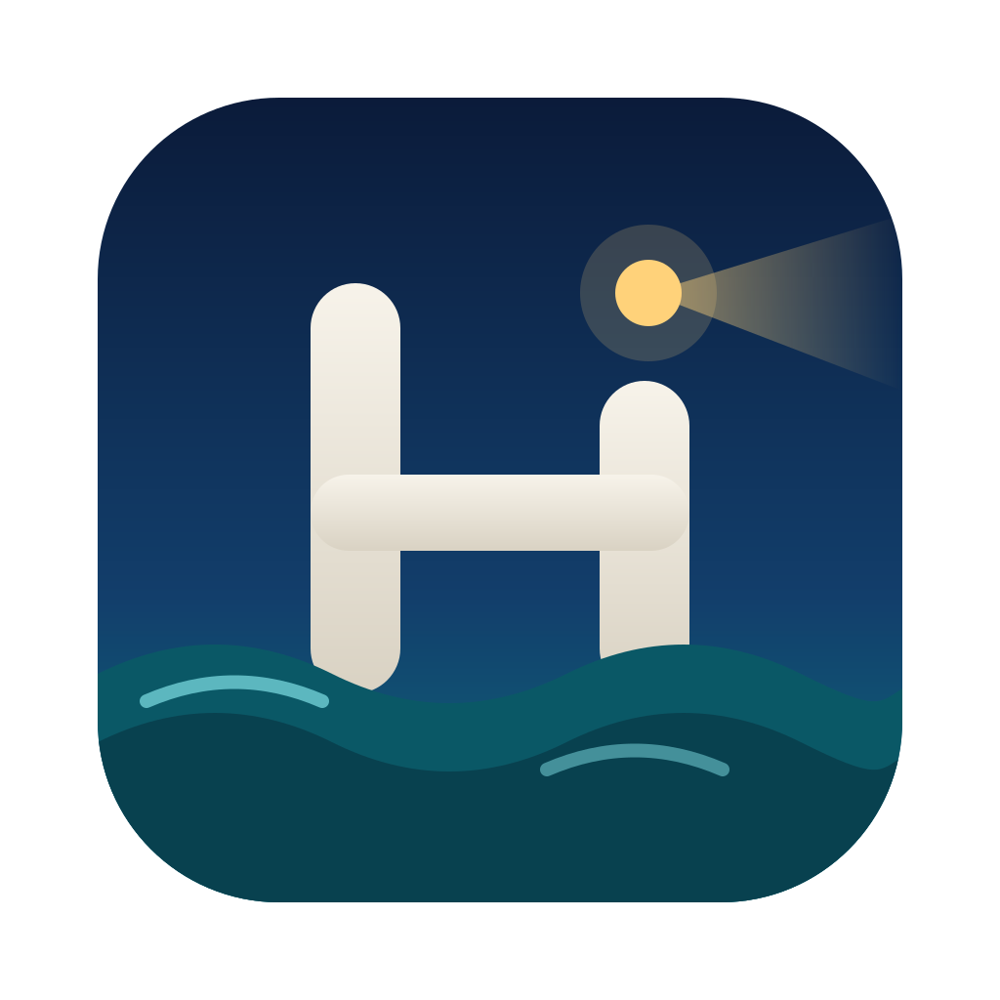

<div align="center">



# Harbor

**Your repos, moored in the menu bar.**

One glance answers one question: *what needs me right now?*

[What it does](#what-it-does) · [Install](#install) · [Privacy](#privacy-and-security) · [Build](#build-from-source) · [CLI](docs/cli.md) · [Contributing](#contributing)

</div>

---

Harbor is a macOS menu-bar app for people who live in more than one repository.
Pin the repos that matter and see their CI, pull requests, releases and local
Git state without opening a browser tab, then jump straight to the thing that
is waiting on you.

## What it does

Click the menu-bar icon and Harbor's own panel opens, drawn in the theme you
chose. Everything below lives in that panel, in memory only: Harbor keeps no
cache of your repositories on disk, and it only writes when you confirm it
inline.

<!-- TODO: screenshot of the panel (Repos tab) in one theme. Render with the debug PanelRenderSnapshot tool; no images are committed yet. -->

| | |
|---|---|
| **Needs you** | One list of what is waiting: failing CI, open security alerts, pull requests that ask for your review (one GitHub search each time the panel opens), and local clones that are behind their upstream, with a fast-forward button on the row. |
| **Repositories** | Pinned or all, with CI status, open issues and pull requests, the latest release and a commit strip. A repo opens a detail pane; Issues, Pull requests, Releases, Workflow runs and Branches each open a list pane (loaded with GraphQL only when you open it). A pull request opens in the panel. |
| **Pull request pane** | Merge readiness in plain words, the checks, and the review threads to resolve. From there you can resolve a thread, update the branch or merge, each behind an inline confirm, and GitHub's own error message is shown if it refuses. |
| **Repo health** | A grade for a repo built from what GitHub lets you see: security alerts, branch protection, signed commits, pinned Actions, workflow token defaults and security policy. Anything you lack the permission to see is marked "not visible" and does not lower the grade. A repo's old workflow runs can be cleaned up after a count and a confirm. |
| **Local Git** | Finds the repos under one or more project folders. For a repo with a local clone: branch, uncommitted changes and ahead/behind; Fetch, Pull (fast-forward only), Sync, Rebase onto upstream, Reset to upstream (red confirm), a branch picker, and Open in Terminal, Finder or your editor. |
| **Worktrees and Tower** | A repo's detail lists its linked worktrees and who made them, read from git and the shared agent ledger (read-only). The Tower tab gathers agent worktrees across your repos into lanes (needs you, working, ready, in review, leftovers). |
| **Harbor view** | A tab with one boat per repository: a storm for failing CI, a list for local drift, and water as high as the repo's latest activity is recent (full today, empty after two weeks). Click a boat to open the repo. |
| **Activity** | Your GitHub contribution heatmap, plus GitLab and Azure DevOps activity counts when you have connected them (an Azure DevOps PAT, a GitLab token). Only activity is shown for those two: repositories, pull requests and CI come from GitHub. |
| **Themes** | Six panel designs ship: Liquid Glass Native, Harbor Brand Navy, Ligne Claire Daylight, Ligne Claire Night Watch, Admiralty Chart and Signal Flags High Contrast. Native and Signal Flags follow light and dark. |
| **Sign-in** | A one-time code at github.com/login/device. Harbor ships no client secret. GitHub Enterprise works with your own OAuth app (enter its host as `ghe.example.com`). |
| **CLI** | `harborcli repos`, `pulls`, `issues`, `local --sync` and more, for scripts and terminals. [Reference](docs/cli.md). |
| **Updates** | Signed, notarized builds that update themselves through Sparkle. |

<!-- TODO: one screenshot per theme, the repo detail with a local clone, a list pane and the Harbor tab. -->

The old system-menu design still exists in the code
(`defaults write com.sriinnu.harbor HarborThemedPanel -bool NO` brings it back)
but it does not have the panes above.

**Not done yet:** repositories and pull requests from GitLab and Azure DevOps
(their activity is the only thing shown today), notifications, and a GitHub
personal access token for organizations that block the OAuth app.

Requires **macOS 15** or later.

## Install

```bash
brew install --cask sriinnu/tap/harbor
```

The cask installs `Harbor.app` and the `harborcli` command. Harbor updates
itself through Sparkle. Or download the zip from
[Releases](https://github.com/sriinnu/harbor/releases/latest).

## Privacy and security

- **No analytics, no tracking, no server of ours.** Harbor talks only to the
  forges you sign in to.
- **Every secret lives in your system's secure store**, never in settings files
  or logs: tokens, OAuth client credentials, Azure DevOps PATs and GitLab
  tokens all go through one `SecretStore`, which is the login Keychain on macOS
  (local to your Mac, never synced to iCloud).
- **Signed and notarized** with a Developer ID, hardened runtime on. Not
  sandboxed, because local Git needs `~/.ssh` and `~/.gitconfig`.
- Found a vulnerability? Report it privately from the repository's
  **Security** tab ("Report a vulnerability"), not in a public issue.

## Build from source

You need Xcode 26 (Swift 6.2), and Node.js with pnpm for the helper scripts.

```bash
git clone https://github.com/sriinnu/harbor.git
cd harbor
pnpm install
pnpm dev          # build, sign, and launch a dev build
```

`pnpm dev` signs with your Apple Development certificate when you have one (so
the Keychain trusts every rebuild) and labels the build, e.g. "Dev build
0.02.0007", in the menu and in Settings → About.

| Command | What it does |
|---|---|
| `pnpm dev` | Package, sign and relaunch a labelled dev build |
| `pnpm dev:watch` | Hot reload: rebuild and relaunch on every save |
| `pnpm verify` | The full gate: strict build, lint, tests, dependency audit, shellcheck |
| `pnpm test` | Tests only |
| `pnpm harbor repos` | Build and run the CLI |
| `./Scripts/build.sh release` | Plain Xcode release build (not signed for distribution) |

Releases are made with `Scripts/release.sh`; see [docs/release.md](docs/release.md).

## Contributing

Run `pnpm verify` before you push. It's the same gate CI and the release script
run, and it fails on:

- any compiler warning (`HARBOR_STRICT=1` turns them into errors),
- any SwiftLint violation,
- a failing, crashed or empty test run,
- a dependency with a known vulnerability (`pnpm audit`, `cargo audit`),
- shellcheck findings in `Scripts/`.

Commits and tags are signed; `main` only changes through pull requests. The
rules agents and humans both follow are in [AGENTS.md](AGENTS.md).

## Other platforms

`harbor-windows/` and `harbor-linux/` are early Tauri prototypes. **Neither
builds today**, and they are not part of any release.

## License

MIT, © 2026 Srinivas Pendela. Harbor began as a fork of Peter Steinberger's
[RepoBar](https://github.com/steipete/RepoBar) (MIT, © 2025); see [LICENSE](LICENSE).
