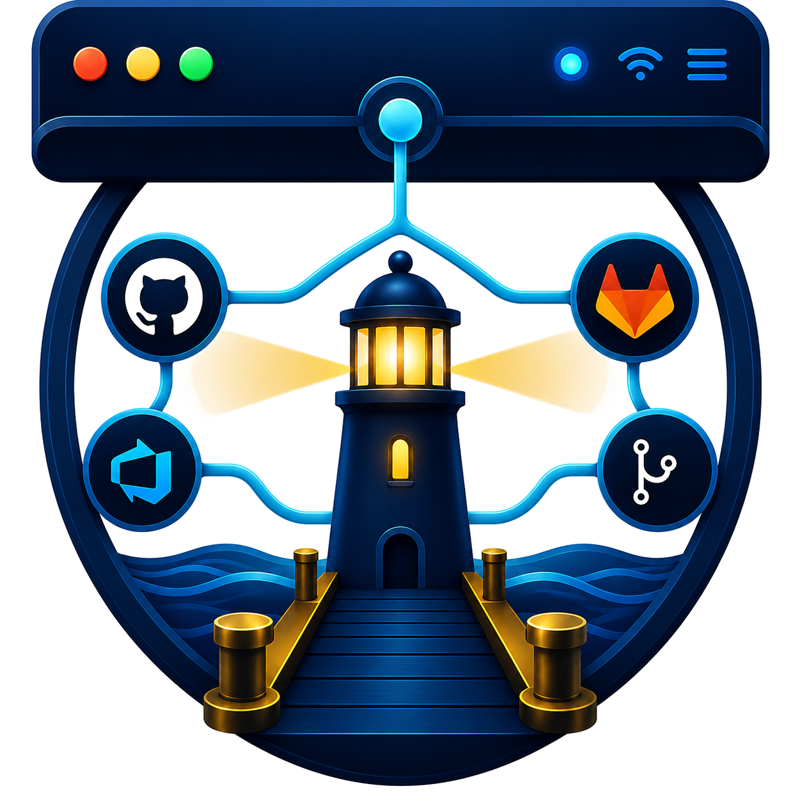

<div align="center">



# Harbor

**Your development work, safely docked in the menu bar.**

GitHub · Azure DevOps · GitLab · Local Git

</div>

---

Harbor pins the repositories that matter and gives you a calm, glanceable view of CI, releases, work items, activity, and local Git state — without ever opening a browser tab.

## Install

```bash
brew install --cask sriinnu/tap/harbor
```

Or grab the latest `.dmg` from [releases](https://github.com/sriinnu/Harbor/releases/latest).

Requires macOS 15+.

## What you get

- **Live cards** — CI status, releases, recent activity, rate limits.
- **Rich submenus** — PRs, issues, releases, workflow runs, tags, branches, commits.
- **Global activity feed** — Contribution heatmaps and per-repo graphs.
- **Local Git** — Auto-matched repos, branch tracking, ahead/behind, dirty state, fast-forward sync.
- **Multi-provider** — GitHub (GraphQL), Azure DevOps (REST), GitLab (cloud + self-hosted).
- **CLI** — `harbor pulls`, `harbor repos`, `harbor sync` for automation.
- **Privacy-first** — Tokens stay in your Keychain. No analytics, no tracking.

## Quick start

1. Launch Harbor — it lives in your menu bar.
2. Sign in with GitHub (OAuth).
3. Pin the repos that matter.
4. Point it at your projects folder for local Git.

Full guide: [docs/user-guide.md](docs/user-guide.md) · CLI reference: [docs/cli.md](docs/cli.md)

## Build from source

```bash
git clone https://github.com/sriinnu/Harbor.git
cd Harbor
./Scripts/build.sh
```

See [docs/building.md](docs/building.md).

## License

MIT — © 2026 Srinivas Pendela. See [LICENSE](LICENSE).
